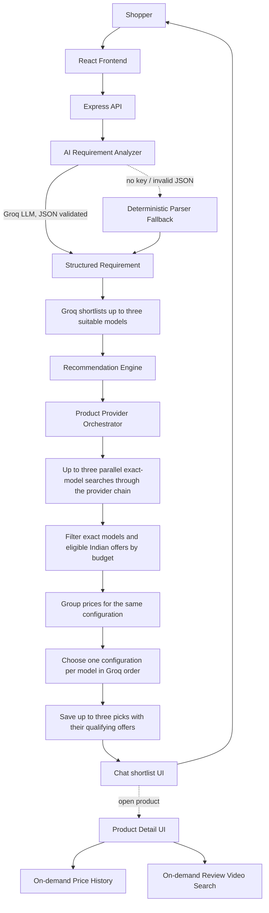

# SmartBuy AI

## Problem

Technology shopping is difficult because people usually know what they want to
*accomplish* — "edit video for my YouTube channel," "survive a CS degree,"
"stop skipping songs mid-run" — without knowing which specifications actually
deliver that. Spec sheets don't translate intent into a decision.

## Solution

SmartBuy AI extracts category, budget and intended use from a shopping request,
then asks Groq to shortlist suitable product models. It searches those models
individually and shows only matching listings with verified
Indian retailer offers inside the budget. Groq chooses the models; shopping
providers supply the prices and seller links. Product pages add price history
and review videos on demand.

```
"Laptop for video editing under ₹80,000"
        ↓
Category: laptop · Budget: ≤₹80,000 · Use case: video editing
        ↓
Groq shortlists up to three suitable laptop models
        ↓
Up to three exact-model searches fetch live offers
        ↓
Exact model matches + Amazon India / Flipkart + INR + price ≤₹80,000
        ↓
Available picks in Groq's order, with the returned live seller prices
```

## Features

- **A real chat interface, not a form** — `/chat` is the primary experience:
  type what you're trying to do, get ranked picks inline in the thread, and
  ask follow-up questions about that shortlist in the same conversation.
  New Session or a category selection starts another product search.
- **Groq-first model selection** — extracted needs such as camera quality,
  gaming, portability and budget guide a shortlist of up to three models for
  every supported category. Only live listings matching those models can
  become recommendations.
- **Prices come from shopping results** — recommendations use returned INR
  offers within the user's budget. Groq does not supply the displayed price.
- **Grounded, explainable recommendations** — every "why we recommend this"
  bullet is generated from a template comparing real product fields against
  your stated requirements. Nothing is AI-hallucinated.
- **Multi-seller price comparison** — recommendations display Amazon India
  and Flipkart offers when the same search response includes both for the
  same configuration. A missing seller price is left unverified.
- **Price history** — recorded lows, highs, and changes in the last 30 days.
  The chart shows a trend once there are at least two recorded prices.
- **YouTube review discovery** — "Watch before you buy," pulling real review
  videos for the exact product via a live API, with a graceful "search
  YouTube instead" fallback if no API key is configured.
- **Product comparison** — pick 2–4 products, get a spec-by-spec table with
  the winning value highlighted per row, and a deterministic "best choice for
  your requirements" verdict.
- **Search history & saved products** — signed-in users get their past
  searches (click to replay) and can save products to revisit.
- **Guided fallback flow** — if your query is too vague to search at all, the
  AI asks one targeted clarifying question; if it's still unclear, you're
  dropped into a short guided step-by-step flow instead of an endless chat.
- **Auth** — JWT access + httpOnly refresh cookie, bcrypt password hashing.
- **Caching** — in-memory TTL cache in front of product search and YouTube
  calls, to avoid redundant external requests.
- **Live recommendations within budget.** The recommender accepts only
  shortlisted models with eligible INR offers. It reports when the search
  returns no matching offer within the requested range. The seeded catalog
  supports browsing separately.

## Architecture



### Backend layout

```
backend/src/
  config/       env loading, MongoDB connection
  models/       User, Product, Recommendation, SearchHistory, PriceHistory
  routes/       Express route definitions
  controllers/  request handlers — thin, call services
  services/
    ai.service.js               Groq client + analyzeRequirement() + suggestProductNames()
    recommendation.service.js   Groq-first selection, live verification, explanations
    productSearch.service.js    live shopping providers and budget filtering
    providers/                  SerpApi and RapidAPI discovery; retailer adapters are not called during recommendations
    price.service.js            price comparison + history
    youtube.service.js          YouTube138 review search + fallback
    cache.service.js            in-memory TTL cache
  utils/
    deterministicParser.js      regex/keyword requirement extraction (AI fallback)
    normalization.js            spec-string → numeric-field normalization
    duplicateDetection.js       same-product detection + seller-offer merging
    comparison.js                spec-by-spec comparison table builder
  validators/   Zod request/response schemas
  seed/         demo catalog + price-history backfill
  __tests__/    node:test suite

frontend/src/
  components/
    landing/    Hero, SearchBox (hands off to /chat), nav
    chat/       Chat.jsx's message thread + inline compact product cards
    results/    PickCard, RequirementSummary, ComparisonTable, MatchGauge
    product/    PriceComparison, PriceHistoryChart, YouTubeReviews
    compare/    CompareTable
    catalog/    ProductCard, FilterBar
    intake/     guided step wizard (the clarification/fallback path)
  pages/        Landing, Results, ProductDetail, Catalog, Compare, History, ...
  store/        Zustand: auth, favorites, compare, intake wizard
  lib/          API client, formatters, intake option config
```

## The recommendation algorithm

**1. Requirement extraction (AI, with a deterministic fallback).** Free text
goes to Groq with a system prompt that explicitly forbids inventing product
facts. This first step infers category, budget, use cases, hard
requirements (e.g. "GPU required," "16GB+ RAM"), and **priority weights**
across seven dimensions (cpu/gpu/ram/storage/display/battery/portability).
The response is Zod-validated; on failure it retries once, then falls back to
`utils/deterministicParser.js` — a regex/keyword engine with hand-tuned
priority presets for gaming, video editing, coding/student, photography,
battery-life, ANC/travel, and gym use cases. The guided wizard normalizes into
the same structured requirement. The parser can work without Groq, but live
recommendations still need Groq for the next step.

**2. Model shortlist.** Before making a shopping request, the engine sends
the structured needs, original query and budget to Groq. It requests up to
three distinct suitable models for any supported category. These are model
suggestions, not verified availability or price quotes. If shortlisting fails,
the app reports that failure instead of substituting unrelated products.
The complete shopping message is the primary input; extracted fields support
it rather than replacing it. Prompts support up to 4,000 characters, with an
explicit error for oversized messages instead of silent clipping. Requested
families such as iPhone or MacBook remain constraints on Groq's shortlist.
Groq's built-in browser research is enabled for this step so model selection
can use current product evidence instead of relying only on training data.
One browser-enabled completion returns researched model names. The server
parses and validates the answer without a second Groq
formatting call. This avoids tool-format conflicts and reduces free-tier token
usage. Identical concurrent or repeated requests share a five-minute shortlist
cache; displayed retailer prices still come from the shopping providers.
It uses the existing Groq key and can add Groq tool usage charges. Set
`GROQ_LIVE_SEARCH=false` to explicitly opt out of live research. Requirement
extraction and follow-up chat do not run browser research.
Live research requires a supported GPT-OSS model; see the
[Groq browser-search documentation](https://console.groq.com/docs/tool-use/built-in-tools/browser-search).

**3. Exact-model live searches.** The engine searches each shortlisted model
individually, with up to three lookups running in parallel. Discovery starts
with SerpApi Google Shopping for India. On provider failure or quota exhaustion, it tries
Real-Time Product Search, Google Search Master MEGA, then standard Google
Search Master. If those sources cannot supply an eligible offer, native Amazon
India search and the configured Flipkart endpoint are final model-search
fallbacks. A provider returning only unrelated, accessory, unapproved-seller or
over-budget results also advances to the next source for the same model.
Those retries can consume additional calls. Repeated queries
can use the five-minute cache.

Recommendation searches send the canonical manufacturer and model supplied by Groq to every provider,
without appending category, budget or use-case keywords. Google Search Master
autocorrection is disabled for these lookups. Provider failures can switch
providers for that same model; an empty or unrelated response also advances
the provider chain without changing the model query. Simultaneous identical provider queries share one
pending request as well as the completed-result cache.

**4. Verification and selection.** Returned listings must match a shortlisted
model and have an eligible Amazon India or Flipkart offer in INR inside the
user's stated budget. Refurbished items, common accessories and different
model suffixes are excluded. The engine chooses one available configuration
per matched model and preserves Groq's model order. If some lookups fail or
return no eligible offer, fewer than three recommendations can be returned.
It does not run separate retailer price requests to fill gaps.
Matching a model name inside a title is not sufficient: the model must be the
primary item and pass a category-aware whole-product check. Cases, compatible
replacement screens, repair parts and standalone charging cases are rejected,
while genuine device bundles remain eligible. The full provider title and
Groq shortlist are saved for inspection. Saved recommendation responses also
apply this check to previously accepted accessory listings.

**5. Persistence and explanation.** Only the selected products and their
qualifying live offers are saved. Listing text supplies any identifiable
RAM, storage and CPU/GPU fields; absent specifications stay unknown.
`generateExplanation()` references verified listing fields and the stated
budget. Groq selection is identified as such rather than shown as a numeric
match percentage. Price-history and video lookups run on demand on product
pages, separately from recommendation discovery.

## Setup

### Quick Start (One Command)

From the project root:

```bash
npm start
```
*(Or `npm run dev` — automatically checks/starts MongoDB, then boots both the Backend API on `:5050` and Frontend on `:5173` concurrently).*

---

### Run with Docker Compose

Start Docker Desktop or Docker Engine with Compose. If `backend/.env` is
missing, copy `backend/.env.example` and set both JWT secrets. For live shopping,
set `USE_MOCK_DATA=false` and add `GROQ_API_KEY` plus your shopping API keys.

```bash
docker compose up --build -d --wait
```

Open [SmartBuy](http://localhost:5173) and check the [API health endpoint](http://localhost:5173/api/health).
Nginx serves the site and forwards `/api` to the backend. MongoDB stays inside
Docker and persists in the `mongo_data` volume. Restarts preserve existing data.

Set `SMARTBUY_PORT` if port 5173 is already in use. For a server deployment,
place your HTTPS reverse proxy in front of the published port and set
`SMARTBUY_PUBLIC_URL` to the site's HTTPS origin. Use `docker compose logs -f`
to follow startup and `docker compose down` to stop the stack.

---

### Manual Setup (Without Docker)

### Prerequisites

- Node.js 20.19+ or 22.12+
- MongoDB (local, or `docker run -d -p 27017:27017 mongo:7`)

### Backend

```bash
cd backend
npm install
cp .env.example .env   # MONGO_URI + two JWT secrets are the only required values
npm run seed             # populates the demo catalog + 30-day price history
npm run dev               # http://localhost:5050
```

### Frontend

```bash
cd frontend
npm install
cp .env.example .env   # defaults to http://localhost:5050/api
npm run dev               # http://localhost:5173
```

### Environment variables

| Variable | Required | Purpose |
|---|---|---|
| `MONGO_URI` | **Yes** | Database connection |
| `JWT_ACCESS_SECRET`, `JWT_REFRESH_SECRET` | **Yes** | Any long random strings |
| `GROQ_API_KEY` | For live recommendations | Model shortlisting, AI requirement parsing and follow-up chat. Requirement extraction can fall back to the deterministic parser; shortlisting and chat require the key. |
| `GROQ_LIVE_SEARCH` | No (default `true`) | Groq browser research for current shortlist models. Uses Groq tool quota/billing; `false` explicitly uses model-only shortlisting. |
| `SERPAPI_KEY` | No | Primary discovery through SerpApi's Google Shopping engine. |
| `RAPIDAPI_KEY` | No | Real-Time Product Search, price history, Google Search Master fallbacks, native Amazon India search, configured Flipkart search, and optional YouTube review search. |
| `USE_MOCK_DATA` | No (default `true`) | Set `false` to enable live recommendations. |
| `YOUTUBE_API_KEY` | No | Alternative to RapidAPI for review search, if you have an official Google YouTube Data API v3 key. |

Live recommendations require `USE_MOCK_DATA=false`, `GROQ_API_KEY`, and at least one of `SERPAPI_KEY` or `RAPIDAPI_KEY`.
Discovery starts with SerpApi Google Shopping for India. If a provider is
unavailable, over quota, or returns no eligible exact-model offer, the order is
Real-Time Product Search, Google Search Master MEGA, standard Google Search
Master, then native Amazon India and configured Flipkart model search.
All sources search the same Groq-selected model; no generic discovery query
is substituted. The first source with an eligible offer stops the chain.
MacBook matching checks the chip, requested configuration and primary product
independently of retailer wording. It recognizes Apple's marketing-size aliases
such as 13-inch versus the 13.6-inch panel, as documented in
[Apple's specifications](https://support.apple.com/en-us/126320).

Groq first proposes up to three suitable models. Each model gets one shopping
search, with no separate retailer quote calls. SmartBuy shows Amazon India
and Flipkart prices when that model's response includes both for the same
configuration and within budget. If a seller's offer is missing, its price
stays unverified. A fresh recommendation can therefore use up to three
shopping calls when each primary-provider lookup succeeds; failures or unusable results
can add fallback calls, and repeated queries can use the five-minute cache.
Opening a product page loads the chart on demand from saved observations and
matching Real-Time Product Search history.

For RapidAPI shopping, the app reads the reported request allowance and stops
issuing new calls to a provider when its balance reaches zero. The balance is
held in the running backend. Check Subscriptions & Usage before restarting
after exhaustion, and prefer RapidAPI plans with a hard limit if you need
account-wide protection from overages.


### Tests

```bash
cd backend
npm test
```

Covers requirement parsing (budget/category/priority extraction), Groq-first
recommendation flow, model identity and budget filtering, provider fallback,
spec normalization (`"16 GB RAM"` → `16`, `"0.5TB"` → `512`), and
duplicate/seller-merge detection. Provider and Groq responses are mocked in
the tests, so running the suite does not use external API quota.

## Deploy to Render

Connect the Git repository as a new [Render Blueprint](https://render.com/docs/infrastructure-as-code).
The Blueprint creates one Node web service that serves the frontend and API
on the same domain. Render generates the session secrets and checks `/api/health`.

Set `MONGO_URI` in Render to a hosted MongoDB database. If it uses an IP access
list, allow the service's [outbound IP ranges](https://render.com/docs/outbound-ip-addresses).
Set `RAPIDAPI_KEY` and/or `SERPAPI_KEY` for live shopping results, and add
`GROQ_API_KEY` for model shortlisting, AI-assisted request parsing and chat. Enter credentials
in Render's environment settings.

The service starts with live search enabled and skips database seeding. If
you attach a custom domain, set `CLIENT_URL` to its full HTTPS origin.

## API reference

| Method | Route | Auth | Description |
|---|---|---|---|
| POST | `/api/auth/signup` | — | Create an account |
| POST | `/api/auth/login` | — | Log in |
| POST | `/api/auth/refresh` | cookie | Rotate access token |
| POST | `/api/auth/logout` | — | Clear refresh cookie |
| POST | `/api/ai/analyze-requirement` | — | Free text → structured requirement |
| GET | `/api/products` | — | List/filter/sort catalog |
| GET | `/api/products/:id` | — | Product detail |
| GET | `/api/products/:id/related` | — | Related products |
| GET | `/api/products/:id/prices` | — | Seller price comparison |
| GET | `/api/products/:id/history` | — | Price history + low/high/% change |
| POST | `/api/products/compare` | — | Spec comparison for 2–4 products |
| POST | `/api/recommendations` | optional | Generate a recommendation (legacy wizard body or AI-derived structured body) |
| GET | `/api/recommendations/:id` | — | Fetch a recommendation |
| GET | `/api/youtube/search?q=` | — | Review video search (or fallback link) |
| GET | `/api/history` | required | Signed-in user's search history |
| POST | `/api/history` | required | Manually log a search |
| GET/POST/DELETE | `/api/users/favorites` | required | Saved products |
| POST | `/api/chat` | — | Follow-up chat about a product or recommendation (requires `GROQ_API_KEY`) |

Chat accepts `message`, optional `history`, and exactly one of `productId` or
`recommendationId`. The product-page advisor retains the selected product;
after a shopping search, follow-up questions refer to that shortlist. Use
New Session or choose a category to start another search. Chat requests have
a 15-second provider timeout and report configuration, usage-limit, or
temporary provider errors separately.

## Demoing this in an interview

1. **Explain the two AI steps.** Requirement extraction reads category,
   budget and intended use; Groq then shortlists suitable model names before
   any shopping lookup. The extraction step has a deterministic fallback,
   while recommendations require the model-shortlisting step to succeed.
2. **Type the spec's own worked example**: *"I am a CSE student. I need a
   laptop mainly for coding, occasional gaming and college work. My budget is
   70k."* — inspect the extracted needs, Groq's model shortlist, then the
   verified live offers. Explain that a suggested model is shown only when
   an eligible listing matches it inside the budget.
3. **Open a product detail page** and walk through price comparison → price
   history → the real YouTube reviews it pulled — three genuinely different
   external data sources in one page, with graceful fallbacks for each if you
   toggle the relevant key off.
4. **Compare 2–3 products** and point at the "best choice" verdict — it's
   computed by counting won spec rows, not another AI call.
5. **Open `backend/src/services/recommendation.service.js`** to show the order
   of operations: Groq model shortlist, exact-model shopping searches,
   budget and seller validation, then persistence. Displayed prices come
   from the shopping responses, not the model's estimates.

## Known limitations

- **Model coverage uses provider quota.** A fresh recommendation can make up
  to three exact-model shopping searches. Provider fallback attempts can
  add calls. The five-minute search cache reduces repeated requests, and
  recommendations make no additional retailer quote or history calls.
- **A shortlist is not a live inventory check.** Groq may suggest a model
  that is unavailable or outside the budget at current prices. Only matching
  eligible offers are displayed; missing models are omitted rather than
  replaced with unrelated results.
- **Live offers can change.** The search cache lasts up to five minutes.
  Saved recommendations show the eligible offers captured when the search ran.
- **Live-ingested products have thinner specs than seeded ones.** The
  product-search API returns a listing title, price, seller, and photo —
  not a structured spec sheet. `ramGB`/`storageGB` get parsed from the title
  when it happens to mention them ("...8GB RAM, 256GB Storage"); CPU/GPU
  tier can be extracted when identifiable in the title; absent display,
  battery and portability facts stay unset. Review the retailer's full
  specifications before buying.
- **Cross-platform spec comparison is crude.** Normalized fields like `ramGB`
  are compared as raw numbers across iOS and Android, even though the same
  RAM figure doesn't mean the same real-world performance on both platforms
  (an 8GB Android phone isn't straightforwardly "better" than a 6GB iPhone).
  The comparison table cannot establish real-world performance from those
  numbers alone.
- **The seeded catalog is demo data.** Seeded products across six categories
  have illustrative seller offers. Live recommendations require the Groq
  and shopping credentials described above and do not use those demo prices.
- **Live prices are recorded when a listing is saved as a recommendation.**
  Listings can start with a single price and build history as they are picked
  again. Seeded products use a separate, labeled demo series.
- **Battery-hours and portability normalization are heuristic**, not
  manufacturer benchmarks (documented inline in `normalization.js`) — good
  enough to rank a small catalog sensibly, not a substitute for a real spec
  database.
- **No automated frontend tests** — backend logic (parsing, normalization,
  scoring, duplicate detection) has unit tests; the frontend was verified
  through manual/browser-driven testing during development, not an automated
  suite.
- **Six supported categories** — smartphone, laptop, headphones, smartwatch,
  tablet and monitor. Keyboards and mice are not currently included.
- **No dedicated `/docs` tree** — architecture, schema, and algorithm
  explanations live in this README rather than separate files.
