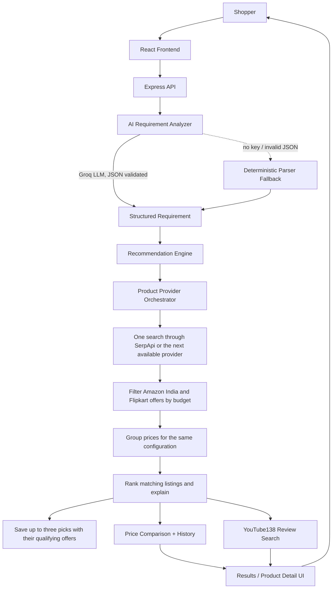

# SmartBuy AI

## Problem

Technology shopping is difficult because people usually know what they want to
*accomplish* — "edit video for my YouTube channel," "survive a CS degree,"
"stop skipping songs mid-run" — without knowing which specifications actually
deliver that. Spec sheets don't translate intent into a decision.

## Solution

SmartBuy AI converts a natural-language shopping requirement into structured
technical criteria, then ranks real products against that criteria using a
transparent, deterministic scoring model — not a black box, and not an LLM
guessing at prices. You get ranked picks, an explanation grounded in the
product's actual specs, multi-seller price comparison, price history, and
review videos, in one flow.

```
"Laptop for video editing under ₹80,000"
        ↓
Category: laptop · Budget: ≤₹80,000 · Use case: video editing
        ↓
Priorities: CPU 30% · GPU 25% · RAM 20% · Storage 10% · Display 10% · ...
        ↓
ASUS TUF Gaming A15 — 88% match — ₹78,499 (Flipkart, best of 3 sellers)
"Dedicated GPU (RTX 4050) accelerates video editing workloads.
 ₹78,499 fits within your ₹80,000 budget. Well suited for video editing."
```

## Features

- **A real chat interface, not a form** — `/chat` is the primary experience:
  type what you're trying to do, get ranked picks inline in the thread, and
  keep refining ("show me something cheaper," "what about gaming instead")
  as follow-up turns in the same conversation. The AI (or, with no AI key
  configured, a deterministic regex/keyword parser) turns each turn into
  structured criteria.
- **Intent-aware recommendation engine** — a gaming request weights GPU/CPU
  heavily; a coding/student request weights RAM/CPU/battery and *not* GPU; a
  travel-headphone request weights battery/portability over raw specs. The
  weighting is dynamic per-request, not a fixed formula.
- **Deterministic scoring, not AI guessing** — `specScore × 0.40 + intentMatchScore × 0.30 + valueScore × 0.15 + ratingScore × 0.10 + priceScore × 0.05`.
  The AI's only job is turning your sentence into structured requirements +
  priority weights; a plain arithmetic engine does the ranking.
- **Grounded, explainable recommendations** — every "why we recommend this"
  bullet is generated from a template comparing real product fields against
  your stated requirements. Nothing is AI-hallucinated.
- **Multi-seller price comparison** — products carry real seller arrays
  (Amazon/Flipkart/Croma/...); best price is always surfaced and highlighted.
- **Price history** — recorded lows, highs, and changes in the last 30 days.
  The chart shows a trend once there are at least two recorded prices.
- **YouTube review discovery** — "Watch before you buy," pulling real review
  videos for the exact product via a live API, with a graceful "search
  YouTube instead" fallback if no API key is configured.
- **Product comparison** — pick 2–4 products, get a spec-by-spec table with
  the winning value highlighted per row, and a deterministic "best choice for
  your requirements" verdict.
- **Search history & saved products** — signed-in users get their past
  searches (click to replay) and can save products to revisit.
- **Guided fallback flow** — if your query is too vague to search at all, the
  AI asks one targeted clarifying question; if it's still unclear, you're
  dropped into a short guided step-by-step flow instead of an endless chat.
- **Auth** — JWT access + httpOnly refresh cookie, bcrypt password hashing.
- **Caching** — in-memory TTL cache in front of product search and YouTube
  calls, to avoid redundant external requests.
- **Live recommendations within budget.** The recommender checks live shopping
  providers and ranks only listings with eligible INR offers. It reports when
  no live listings meet the requested range. The seeded catalog supports
  browsing separately.

## Architecture



### Backend layout

```
backend/src/
  config/       env loading, MongoDB connection
  models/       User, Product, Recommendation, SearchHistory, PriceHistory
  routes/       Express route definitions
  controllers/  request handlers — thin, call services
  services/
    ai.service.js               Groq client + analyzeRequirement() + suggestProductNames()
    recommendation.service.js   deterministic scoring/ranking/explanation engine
    productSearch.service.js    live shopping providers and budget filtering
    providers/                  SerpApi and RapidAPI discovery, Amazon India and Flipkart quotes
    price.service.js            price comparison + history
    youtube.service.js          YouTube138 review search + fallback
    cache.service.js            in-memory TTL cache
  utils/
    deterministicParser.js      regex/keyword requirement extraction (AI fallback)
    normalization.js            spec-string → numeric-field normalization
    duplicateDetection.js       same-product detection + seller-offer merging
    comparison.js                spec-by-spec comparison table builder
  validators/   Zod request/response schemas
  seed/         demo catalog + price-history backfill
  __tests__/    node:test suite

frontend/src/
  components/
    landing/    Hero, SearchBox (hands off to /chat), nav
    chat/       Chat.jsx's message thread + inline compact product cards
    results/    PickCard, RequirementSummary, ComparisonTable, MatchGauge
    product/    PriceComparison, PriceHistoryChart, YouTubeReviews
    compare/    CompareTable
    catalog/    ProductCard, FilterBar
    intake/     guided step wizard (the clarification/fallback path)
  pages/        Landing, Results, ProductDetail, Catalog, Compare, History, ...
  store/        Zustand: auth, favorites, compare, intake wizard
  lib/          API client, formatters, intake option config
```

## The recommendation algorithm

**1. Requirement extraction (AI, with a deterministic fallback).** Free text
goes to Groq with a system prompt that explicitly forbids inventing product
facts — its only job is inferring category, budget, use cases, hard
requirements (e.g. "GPU required," "16GB+ RAM"), and **priority weights**
across seven dimensions (cpu/gpu/ram/storage/display/battery/portability).
The response is Zod-validated; on failure it retries once, then falls back to
`utils/deterministicParser.js` — a regex/keyword engine with hand-tuned
priority presets for gaming, video editing, coding/student, photography,
battery-life, ANC/travel, and gym use cases. This fallback is not a degraded
experience — it's the same code path a guided-wizard search normalizes into.

**2. Candidate retrieval.** The engine searches live providers for suggested
model names first. If no offers qualify, it tries a keyword search. Each offer
must be in INR and within the requested price range before the engine ranks it.
Only the final picks and their eligible offers are stored for later review.

**3. Normalization.** Each product's human-readable specs (`"16GB DDR5"`,
`"0.5TB"`, `"RTX 4050 6GB"`) are pre-normalized at seed/ingestion time via
`utils/normalization.js` into numeric fields (`ramGB`, `storageGB`, `cpuTier`
0–5, `gpuTier` 0–5, `displayScore`, `batteryHours`, `portabilityScore`) — the
scoring engine never parses strings at request time.

**4. Scoring.**

```
final = specScore × 0.40
      + intentMatchScore × 0.30
      + valueScore × 0.15
      + ratingScore × 0.10
      + priceScore × 0.05
```

- `specScore` — each normalized dimension (0–1, relative to the candidate
  set's max) weighted by the priorities from step 1. This is where "dynamic
  weighting based on intent" actually happens — GPU counts for ~0 in a
  student-laptop request and ~30% in a gaming request.
- `intentMatchScore` — fraction of stated use cases the product's tagged use
  cases satisfy, plus pass/fail checks against hard requirements (RAM
  minimum, GPU required, ANC required, etc).
- `valueScore` — spec score per rupee, relative to the candidate set.
- `ratingScore` — normalized product rating.
- `priceScore` — 0 if over budget; otherwise rewards being close to (without
  exceeding) the stated budget.

**5. Explanation.** `generateExplanation()` builds bullet points from
template strings referencing the actual comparison (`"${ramGB}GB RAM meets
your ${minimum}GB+ requirement"`), never from free-form AI text — this is
literally what makes the recommendations auditable rather than hallucinated.
A separate `generateTradeoff()` picks one honest downside (priced above most
alternatives, rated lower, GPU present but modest, etc).

## Setup

### Quick Start (One Command)

From the project root:

```bash
npm start
```
*(Or `npm run dev` — automatically checks/starts MongoDB, then boots both the Backend API on `:5050` and Frontend on `:5173` concurrently).*

---

### Run with Docker Compose

Start Docker Desktop or Docker Engine with Compose. If `backend/.env` is
missing, copy `backend/.env.example` and set both JWT secrets. For live shopping,
set `USE_MOCK_DATA=false` and add your shopping API keys.

```bash
docker compose up --build -d --wait
```

Open [SmartBuy](http://localhost:5173) and check the [API health endpoint](http://localhost:5173/api/health).
Nginx serves the site and forwards `/api` to the backend. MongoDB stays inside
Docker and persists in the `mongo_data` volume. Restarts preserve existing data.

Set `SMARTBUY_PORT` if port 5173 is already in use. For a server deployment,
place your HTTPS reverse proxy in front of the published port and set
`SMARTBUY_PUBLIC_URL` to the site's HTTPS origin. Use `docker compose logs -f`
to follow startup and `docker compose down` to stop the stack.

---

### Manual Setup (Without Docker)

### Prerequisites

- Node.js 20.19+ or 22.12+
- MongoDB (local, or `docker run -d -p 27017:27017 mongo:7`)

### Backend

```bash
cd backend
npm install
cp .env.example .env   # MONGO_URI + two JWT secrets are the only required values
npm run seed             # populates the demo catalog + 30-day price history
npm run dev               # http://localhost:5050
```

### Frontend

```bash
cd frontend
npm install
cp .env.example .env   # defaults to http://localhost:5050/api
npm run dev               # http://localhost:5173
```

### Environment variables

| Variable | Required | Purpose |
|---|---|---|
| `MONGO_URI` | **Yes** | Database connection |
| `JWT_ACCESS_SECRET`, `JWT_REFRESH_SECRET` | **Yes** | Any long random strings |
| `GROQ_API_KEY` | No | AI requirement parsing + follow-up chat. Falls back to a deterministic parser; chat is disabled without it. |
| `SERPAPI_KEY` | No | Primary discovery through SerpApi's Google Shopping engine. |
| `RAPIDAPI_KEY` | No | Real-Time Product Search, price history, both Google Search Master fallbacks, and optional YouTube review search. |
| `USE_MOCK_DATA` | No (default `true`) | Set `false` to enable live recommendations. |
| `YOUTUBE_API_KEY` | No | Alternative to RapidAPI for review search, if you have an official Google YouTube Data API v3 key. |

Live recommendations require `USE_MOCK_DATA=false` and at least one of `SERPAPI_KEY` or `RAPIDAPI_KEY`.
Discovery starts with SerpApi Google Shopping for India. If a provider is
unavailable or over quota, the order is Real-Time Product Search, Google
Search Master MEGA, then standard Google Search Master. A successful empty
result stays with the responding provider.

Each recommendation uses the prices and seller links in a single shopping
response. SmartBuy shows Amazon India and Flipkart prices when the response
includes both for the same configuration and within budget. If a seller's offer
is missing, its price stays blank. Opening a product page loads the chart on
demand from saved observations and matching Real-Time Product Search history.

For RapidAPI shopping, the app reads the reported request allowance and stops
issuing new calls to a provider when its balance reaches zero. The balance is
held in the running backend. Check Subscriptions & Usage before restarting
after exhaustion, and prefer RapidAPI plans with a hard limit if you need
account-wide protection from overages.


### Tests

```bash
cd backend
npm test
```

Covers requirement parsing (budget/category/priority extraction), spec
normalization (`"16 GB RAM"` → `16`, `"0.5TB"` → `512`), scoring (a matching
product outranks a non-matching one; over-budget products never win on
price), and duplicate/seller-merge detection.

## Deploy to Render

Connect the Git repository as a new [Render Blueprint](https://render.com/docs/infrastructure-as-code).
The Blueprint creates one Node web service that serves the frontend and API
on the same domain. Render generates the session secrets and checks `/api/health`.

Set `MONGO_URI` in Render to a hosted MongoDB database. If it uses an IP access
list, allow the service's [outbound IP ranges](https://render.com/docs/outbound-ip-addresses).
Set `RAPIDAPI_KEY` and/or `SERPAPI_KEY` for live shopping results, and add
`GROQ_API_KEY` for AI-assisted request parsing and chat. Enter credentials
in Render's environment settings.

The service starts with live search enabled and skips database seeding. If
you attach a custom domain, set `CLIENT_URL` to its full HTTPS origin.

## API reference

| Method | Route | Auth | Description |
|---|---|---|---|
| POST | `/api/auth/signup` | — | Create an account |
| POST | `/api/auth/login` | — | Log in |
| POST | `/api/auth/refresh` | cookie | Rotate access token |
| POST | `/api/auth/logout` | — | Clear refresh cookie |
| POST | `/api/ai/analyze-requirement` | — | Free text → structured requirement |
| GET | `/api/products` | — | List/filter/sort catalog |
| GET | `/api/products/:id` | — | Product detail |
| GET | `/api/products/:id/related` | — | Related products |
| GET | `/api/products/:id/prices` | — | Seller price comparison |
| GET | `/api/products/:id/history` | — | Price history + low/high/% change |
| POST | `/api/products/compare` | — | Spec comparison for 2–4 products |
| POST | `/api/recommendations` | optional | Generate a recommendation (legacy wizard body or AI-derived structured body) |
| GET | `/api/recommendations/:id` | — | Fetch a recommendation |
| GET | `/api/youtube/search?q=` | — | Review video search (or fallback link) |
| GET | `/api/history` | required | Signed-in user's search history |
| POST | `/api/history` | required | Manually log a search |
| GET/POST/DELETE | `/api/users/favorites` | required | Saved products |
| POST | `/api/chat` | — | Follow-up chat about a product or recommendation (requires `GROQ_API_KEY`) |

Chat accepts `message`, optional `history`, and exactly one of `productId` or
`recommendationId`. The product-page advisor retains the selected product;
after a shopping search, follow-up questions refer to that shortlist. Use
New Session or choose a category to start another search. Chat requests have
a 15-second provider timeout and report configuration, usage-limit, or
temporary provider errors separately.

## Demoing this in an interview

1. **Show the zero-key path first.** Stop the backend, unset `GROQ_API_KEY` in
   `.env`, restart — the app still fully works via the deterministic parser.
   This is the single strongest "I thought about reliability" moment.
2. **Type the spec's own worked example**: *"I am a CSE student. I need a
   laptop mainly for coding, occasional gaming and college work. My budget is
   70k."* — narrate that the priority weights it returns favor RAM/CPU/battery
   over GPU, and explain why (unlike a naive "highest spec wins" system).
3. **Open a product detail page** and walk through price comparison → price
   history → the real YouTube reviews it pulled — three genuinely different
   external data sources in one page, with graceful fallbacks for each if you
   toggle the relevant key off.
4. **Compare 2–3 products** and point at the "best choice" verdict — it's
   computed by counting won spec rows, not another AI call.
5. **Open `backend/src/services/recommendation.service.js`** if asked "so
   where's the AI actually used" — the honest answer is "one call, for NLU
   only," and being able to point at exactly that line is the point.

## Known limitations

- **Named-product search costs more live-provider quota per recommendation
  than a single keyword search.** Asking the AI for 4-6 real product names
  and searching each one individually means up to ~5 live searches for one
  `/api/recommendations` call, instead of 1. Each name-search is cached (like
  every other live query), so repeating the same product name within the TTL
  window is free, but a fresh request can burn through SerpApi's monthly
  budget faster than the single-search architecture did. Fine for a resume
  demo's actual usage volume; would need batching or a larger paid tier
  before any real traffic.
- **Live offers can change.** The search cache lasts up to five minutes.
  Saved recommendations show the eligible offers captured when the search ran.
- **Live-ingested products have thinner specs than seeded ones.** The
  product-search API returns a listing title, price, seller, and photo —
  not a structured spec sheet. `ramGB`/`storageGB` get parsed from the title
  when it happens to mention them ("...8GB RAM, 256GB Storage"); CPU/GPU
  tier, display, battery, and portability are left unset for live products,
  which the scoring engine treats as neutral rather than crashing on, but it
  does mean a live-ingested product is scored on less information than a
  hand-curated seeded one.
- **Cross-platform spec comparison is crude.** Normalized fields like `ramGB`
  are compared as raw numbers across iOS and Android, even though the same
  RAM figure doesn't mean the same real-world performance on both platforms
  (an 8GB Android phone isn't straightforwardly "better" than a 6GB iPhone).
  This is a genuinely hard problem for any numeric-spec-based engine and
  isn't fully solved here — `valueScore` was reworked to be budget-relative
  (see `recommendation.service.js`) specifically to reduce this effect, but
  it doesn't eliminate it.
- **Demo catalog, not live retail data.** 28 seeded products across 6
  categories with real-shaped multi-seller pricing; `USE_MOCK_DATA=false` +
  `RAPIDAPI_KEY` switches to live search, but this wasn't load-tested against
  the live API's actual field names beyond the request/response shape I could
  verify directly.
- **Live prices are recorded when a listing is saved as a recommendation.**
  Listings can start with a single price and build history as they are picked
  again. Seeded products use a separate, labeled demo series.
- **Battery-hours and portability normalization are heuristic**, not
  manufacturer benchmarks (documented inline in `normalization.js`) — good
  enough to rank a small catalog sensibly, not a substitute for a real spec
  database.
- **No automated frontend tests** — backend logic (parsing, normalization,
  scoring, duplicate detection) has unit tests; the frontend was verified
  through manual/browser-driven testing during development, not an automated
  suite.
- **Categories: keyboards and mice aren't included** — the six implemented
  categories (smartphone, laptop, headphones, smartwatch, tablet, monitor)
  cover the recommendation-engine dimensions meaningfully; keyboards/mice
  would mostly pad the category count without exercising anything new in the
  scoring model.
- **No dedicated `/docs` tree** — architecture, schema, and algorithm
  explanations live in this README rather than separate files.
